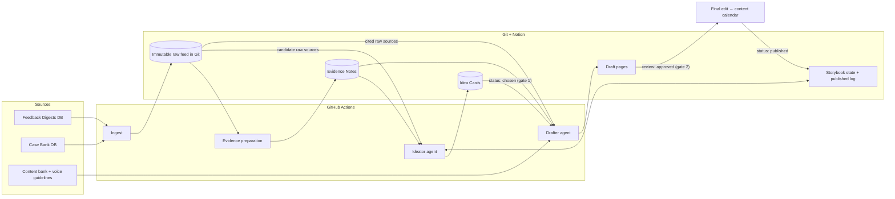

# OV Content Pipeline — SPEC

A two-agent pipeline that turns raw source material into publication-ready
drafts. The pipeline is a **state machine**: state lives in Notion, transitions
fire only on a cron tick or a button press, and the two creative agents are the
**ideator** and **drafter**. Source preparation may use a structured LLM
extraction job for digests, but it is not a creative agent. Two human gates —
idea selection and draft approval — are worked entirely in Notion.

## Operator buttons (GitHub workflow dispatch)

| Button | Does |
|---|---|
| **init** | Provision Notion → ingest sources → prepare evidence. Zero to ready. |
| **prepare** | Prepare new raw files; optional `limit` bounds raw items per run. |
| **ideate** | Generate idea cards (`proposed`) on demand. |
| **draft** | Draft all `chosen` cards, or one card via the `idea_id` input. |
| **reset** | Archive rows and drafts, re-seed storybook state, clear the feed. Requires typing `reset`. |

Cron runs the steady state (ingest + ideate daily, draft poll every 15 min);
the buttons cover demos, catch-up, and do-overs.

## Components

### 1. Sources and ingestion

Each source database (Feedback Digests, Case Bank) is snapshotted into dated
markdown files under `feed/raw/<source>/`. Already-ingested rows are tracked in
a committed state file, so runs are idempotent. The content bank and voice
guidelines live in the repo and are read directly.

Raw files are the immutable evidence of record. Their front matter — including
curated chapters, flags, and article URLs — is part of the evidence contract
and is never stripped before downstream use.

### 2. Evidence preparation

Trigger: push to `feed/raw/**`, or the button.

**Case Bank:** copied deterministically into an Evidence Note. These entries
are already curated, so no LLM rewrite is applied. What happened, thesis tie,
post angle, caution, source, chapters, flags, and article URL survive intact.

**Digests:** a structured extraction job produces one or more arc-neutral theme
packets per raw digest. Packets contain claims, objections, open questions,
tensions, examples, attributed verbatim quotes, numbers with conditions,
cautions, thesis relevance, and relevant chapters. It excludes operational
noise and never forces material into the current chapter.

Every note records its raw path. `feed/evidence-manifest.json` maps each raw
file to one or more Evidence Note IDs. Notes are retrieval aids; they never
replace the raw source.

### 3. Narrative state

A `Storybook / State` page tracks the current chapter, its open question, the
handoff question, beats in play, and real-world anchors. A
`Storybook / Published Log` records what has shipped. The ideator reads both —
and writes back — so the pipeline has memory and does not re-propose published
angles.

### 4. Ideator agent

Trigger: daily schedule, or the button.

The ideator shortlists Evidence Notes whose beats match the current chapter,
then reads their metadata, note bodies, and complete raw sources. It creates
**Idea Card** rows (`status: proposed`) containing:

- hook, central tension, and why the idea serves the chapter
- a basic outline, chapter and question, beats, and suggested format
- citations back to Evidence Notes
- binding cautions and overclaims the drafter must avoid

Raw sources are authoritative when a note omits or distorts them.

### 5. Gate 1 — idea selection (human)

The team opens the *Ideas awaiting selection* view in Notion, reads cards, and
sets `status` to `chosen` or `rejected`. That dropdown flip is the entire
interface — no terminal, no GitHub.

### 6. Drafter agent

Trigger: 15-min poll, or the button.

The drafter picks up cards with `status: chosen` and combines the card, linked
Evidence Notes, **the complete raw sources cited by the card**, matching format
rules, voice guidelines, and the lines bank. It produces a draft page in Notion
and sets `status: drafted`, `review: pending`.

The drafter sees only selected raw sources, not the whole corpus. Card and
source cautions are binding. A missing raw mapping fails loudly; the drafter
never falls back to summary-only evidence.

### 7. Gate 2 — draft approval (human)

The *Drafts awaiting approval* view surfaces drafts with `review: pending`.
Approval moves the piece to final edit and the content calendar; shipping sets
`status: published`, closing the loop into the published log.

## Notion surface

| Object | Type | Purpose |
|---|---|---|
| Idea Cards | database | one row per idea, `proposed → chosen → drafted → published/rejected` |
| Evidence Notes | database | one row per Case Bank item or digest theme, with source, date, beats |
| Storybook / State, Published Log | pages | narrative arc state and ship history |
| Voice / *, Formats / * | pages | drafting rules, one page per source file |
| Drafts | pages | linked from their idea card |

Two filtered views, shared as URLs, are the team's entire interface:
*Ideas awaiting selection* (`status = proposed`) and
*Drafts awaiting approval* (`status = drafted`, `review = pending`).

## Runtime

| Workflow | Trigger | Does |
|---|---|---|
| `init.yml` | manual | provision Notion → ingest → prepare evidence |
| `ingest.yml` | daily schedule, manual | source DBs → dated `feed/raw/` files |
| `prepare.yml` | push to `feed/raw/**`, manual | raw files → Evidence Notes + manifest |
| `ideate.yml` | daily schedule, manual | current-chapter notes + raw sources → Idea Cards |
| `draft.yml` | 15-min poll, manual | chosen cards + cited raw sources → drafts |
| `reset.yml` | manual, guarded | archive state, re-seed, clean slate |

The prepare and init workflows commit the evidence manifest even after partial
failure, preserving completed raw items for the next run.

## Configuration

All environment- and provider-specific values are secrets, never code:

| Secret | Purpose |
|---|---|
| `NOTION_API_KEY` | integration token scoped to the pipeline pages |
| `NOTION_ROOT_PAGE_ID` | root page under which all databases live |
| `LLM_BASE_URL` | OpenAI-compatible API endpoint |
| `LLM_API_KEY` | provider key |
| `LLM_MODEL` | model name |

Prompts are stable, provider-agnostic, and live in `prompts/`. No stage depends
on a specific model; switching providers is a settings change.

## Compatibility and migration

New installations use `evidence_notes_db` and `feed/evidence-manifest.json`.
The code also accepts legacy `distilled_notes_db` and
`distilled-manifest.json` names. Existing lossy Distilled Notes without a
raw-source manifest must be regenerated before ideation or drafting; legacy id
compatibility does not make their missing evidence recoverable.

## Design principles

- **Machine first:** deterministic plumbing, two creative agents, and explicit
  cron/button transitions.
- **Reversible compression:** summaries aid retrieval; raw sources remain
  addressable and authoritative.
- **Task-scoped context:** ideation gets candidate breadth, drafting gets
  selected-source depth. Neither depends on a lossy handoff.
- **Structured handoffs:** stages exchange strict JSON and database rows, so
  behavior is auditable.
- **Humans decide, agents prepare:** automation stops at the two gates.
- **Exit ramp:** prompts, adapters, manifest, and raw corpus live in Git; Notion
  state exports via the API. Nothing is locked into a vendor.
