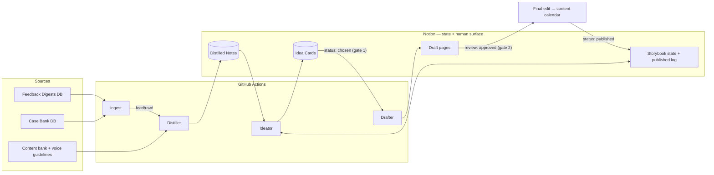

# OV Content Pipeline — SPEC

An agentic pipeline that turns raw source material into publication-ready
drafts. The pipeline is a **state machine**: state lives in Notion, transitions
fire only on a cron tick or a button press, and AI appears in exactly three
places — **distiller, ideator, drafter**. Everything else is deterministic
code. Two human gates (idea selection, draft approval) are worked entirely in
Notion.

## Operator buttons (GitHub workflow dispatch)

| Button | Does |
|---|---|
| **init** | Provision the Notion surface → ingest sources → distill. Zero to ready. |
| **ideate** | Generate idea cards (`proposed`) on demand. |
| **draft** | Draft all `chosen` cards, or one card via the `idea_id` input. |
| **reset** | Archive all rows and drafts, re-seed storybook state, clear the feed. Requires typing `reset`. |

Cron runs the steady state (ingest + ideate daily, draft poll every 15 min);
the buttons cover demos, catch-up, and do-overs.

## Components

### 1. Sources and ingestion

Each source database (Feedback Digests, Case Bank) is snapshotted by the
ingest workflow into dated markdown files under `feed/raw/<source>/`.
Already-ingested rows are tracked in a committed state file, so runs are
idempotent. The content bank and voice guidelines live in the repo and are
read directly — never distilled.

Raw feed never leaves the repo and never reaches the drafting stage.

### 2. Distiller

Trigger: push to `feed/raw/**`.

Compresses each raw file into a structured note: claims, case studies, quotable
lines, why it matters to the thesis, which storybook beats it touches. Output
is strict JSON between stages, written as a row in the **Distilled Notes**
database. Malformed output fails loudly and writes nothing.

### 3. Narrative state

A `Storybook / State` page tracks where the content arc stands: current
chapter, the question it opened with, the question it must hand off, beats in
play, real-world anchors. A `Storybook / Published Log` records what has
shipped. The ideator reads both — and writes back — so the pipeline has memory
and does not re-propose published angles.

### 4. Ideator

Trigger: daily schedule, or the button.

Matches distilled notes to the current chapter's question and creates **Idea
Card** rows (`status: proposed`): hook, a basic outline, chapter and question
served, beats touched, suggested format, and citations back to the distilled
notes.

### 5. Gate 1 — idea selection (human)

The team opens the *Ideas awaiting selection* view in Notion, reads cards, and
sets `status` to `chosen` or `rejected`. That dropdown flip is the entire
interface — no terminal, no GitHub.

### 6. Drafter

Trigger: 15-min poll, or the button.

Picks up cards with `status: chosen`, combines the card (hook + outline), its
linked distilled notes, the matching format rules, the voice guidelines, and
the lines bank, and produces a draft page in Notion. Sets `status: drafted`,
`review: pending`. The drafter never sees raw feed — its context stays clean.

### 7. Gate 2 — draft approval (human)

The *Drafts awaiting approval* view surfaces drafts with `review: pending`.
Approval moves the piece to final edit and the content calendar; shipping sets
`status: published`, which closes the loop back into the published log.

## Notion surface

| Object | Type | Purpose |
|---|---|---|
| Idea Cards | database | one row per content idea, `proposed → chosen → drafted → published/rejected` |
| Distilled Notes | database | one row per distilled raw input, with source, date, beats |
| Storybook / State, Published Log | pages | narrative arc state and ship history |
| Voice / *, Formats / * | pages | drafting rules, one page per source file |
| Drafts | pages | linked from their idea card |

Two filtered views, shared as URLs, are the team's entire interface:
*Ideas awaiting selection* (`status = proposed`) and
*Drafts awaiting approval* (`status = drafted`, `review = pending`).

## Runtime

| Workflow | Trigger | Does |
|---|---|---|
| `init.yml` | manual | provision Notion → ingest → distill |
| `ingest.yml` | daily schedule, manual | source DBs → dated `feed/raw/` files |
| `distill.yml` | push to `feed/raw/**`, manual | raw files → Distilled Notes rows |
| `ideate.yml` | daily schedule, manual | notes + storybook state → Idea Card rows |
| `draft.yml` | 15-min poll, manual | chosen cards → draft pages |
| `reset.yml` | manual, guarded | archive all state, re-seed, clean slate |

## Configuration

All environment- and provider-specific values are secrets, never code:

| Secret | Purpose |
|---|---|
| `NOTION_API_KEY` | integration token scoped to the pipeline pages |
| `NOTION_ROOT_PAGE_ID` | root page under which all databases live |
| `LLM_BASE_URL` | OpenAI-compatible API endpoint |
| `LLM_API_KEY` | provider key |
| `LLM_MODEL` | model name |

Prompts are stable, provider-agnostic, and live in `prompts/`. No stage depends
on a specific model; switching providers is a settings change.

## Design principles

- **Machine first:** the pipeline is deterministic plumbing with three AI
  stages inside it; transitions are cron ticks or button presses.
- **Three stage-scoped agents**, not one end-to-end agent: cadences differ, the
  drafter's context must stay clean, and a broken source must not block
  drafting.
- **Structured handoffs:** stages exchange strict JSON and database rows, so
  behavior is deterministic and auditable.
- **Humans decide, agents prepare:** automation stops at the two gates.
- **Exit ramp:** prompts, adapters, and the raw corpus live in git; Notion
  state exports via the API. Nothing is locked into a vendor.
